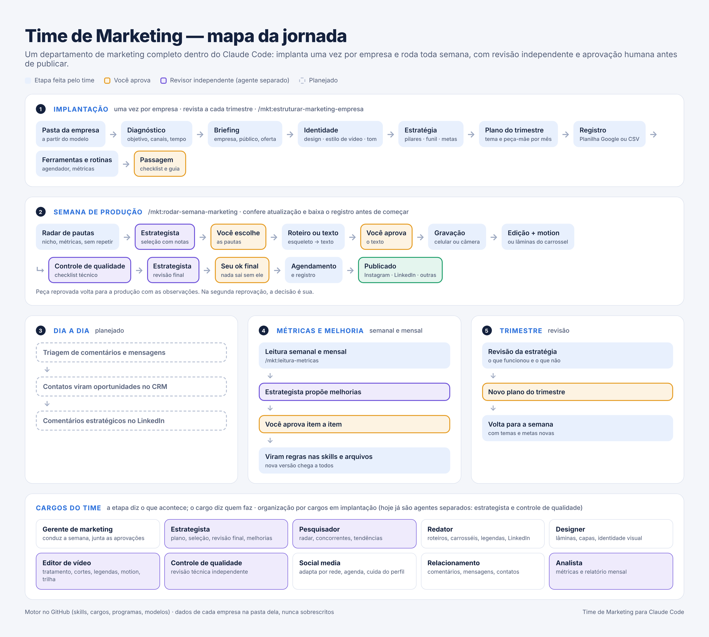

# Time de Marketing para Claude Code

Um departamento de marketing completo dentro do Claude Code. Você implanta uma vez por empresa e, a partir daí, o time roda toda semana: pesquisa pautas, escreve roteiros e carrosséis, edita vídeos com motion graphics (animações de texto, números e telas), revisa com olhar independente, agenda, mede e aprende. **Nada é publicado sem a sua aprovação.**

Feito em português do Brasil, para empresas que querem constância nas redes sem montar uma equipe inteira. **Todas as respostas, perguntas e arquivos do time são em português.**

> **Já instalou e quer atualizar?** No Claude Code, peça **"atualiza o time de marketing"** (ou digite `/mkt:atualizar-time`). Ele confere a versão, mostra o que mudou, atualiza com a sua autorização e confere as configurações iniciais. Depois, digite `/reload-plugins`. Detalhes em [Atualizações](#atualizações).



---

## Sumário
- [O que você recebe](#o-que-você-recebe)
- [Como funciona](#como-funciona)
- [Cargos do time](#cargos-do-time)
- [Comandos](#comandos)
- [Requisitos](#requisitos)
- [Instalação](#instalação)
- [Configuração inicial](#configuração-inicial)
- [Primeiro uso](#primeiro-uso)
- [A semana na prática](#a-semana-na-prática)
- [Onde ficam as coisas](#onde-ficam-as-coisas)
- [Registro: Planilha Google ou arquivos](#registro-planilha-google-ou-arquivos)
- [Design da marca](#design-da-marca)
- [Vídeos com motion graphics](#vídeos-com-motion-graphics)
- [Atualizações](#atualizações)
- [Ferramentas externas](#ferramentas-externas)
- [Regras de qualidade](#regras-de-qualidade)
- [Perguntas frequentes](#perguntas-frequentes)
- [Licença e créditos](#licença-e-créditos)

---

## O que você recebe
- **Implantação guiada por empresa:** diagnóstico (objetivo, jogo do mercado, modelo de crescimento e maturidade nos 4 pilares de receita), briefing, identidade (design, estilo de vídeo, tom de voz, provas, regras do setor, fotos), estratégia com pilar de crescimento, plano do trimestre, registro e rotinas. Um passo de cada vez, sempre com a sua validação.
- **Rotina semanal conduzida:** um painel mostra o que está em cada etapa e o que depende de você.
- **Produção:** roteiros de Reels, TikTok e Shorts; carrosséis prontos em imagem (PNG) e PDF para o LinkedIn, na identidade da marca; edição de vídeo a partir da gravação bruta.
- **Revisão independente:** um estrategista e um controle de qualidade que avaliam sem ter participado da produção e dão notas.
- **Memória e aprendizado:** tudo fica registrado (o que foi pensado, produzido, publicado e aprendido). O time confere repetição de pautas e transforma erros recorrentes em regras.
- **Várias empresas, um só motor:** cada empresa tem a sua pasta; as regras e os programas são os mesmos para todas.

## Como funciona
| Ciclo | Quando | O que acontece |
|---|---|---|
| **1. Implantação** | Uma vez por empresa (revista a cada trimestre) | Monta a pasta da empresa e todo o contexto que o time precisa |
| **2. Semana** | Toda semana | Radar de pautas → seleção do estrategista → **você escolhe** → roteiro ou texto → **você aprova** → gravação → edição ou lâminas → controle de qualidade → revisão final → **seu ok** → agendamento |
| **3. Dia a dia** | Diário *(planejado)* | Triagem de comentários e mensagens, contatos que viram oportunidades |
| **4. Métricas e melhoria** | Semanal e mensal | Leitura de resultados, melhorias propostas, **você aprova**, viram regras |
| **5. Trimestre** | A cada 3 meses | Revisão da estratégia e novo plano |

Peça reprovada volta para a produção com as observações. Na segunda reprovação, a decisão é sua.

## Cargos do time
A etapa diz **o que** acontece; o cargo diz **quem** faz. Os cargos marcados como agente trabalham separados da conversa, para avaliar sem viés ou fazer trabalho pesado.

| Cargo | O que faz | Forma |
|---|---|---|
| Gerente de marketing | Conduz a semana, cobra pendências, junta as aprovações | Na conversa |
| Estrategista | Plano, seleção de pautas, revisão final, melhorias | **Agente** |
| Pesquisador | Radar, concorrentes, tendências | Agente *(em implantação)* |
| Redator | Roteiros, textos de carrossel, legendas, LinkedIn | Na conversa |
| Designer | Lâminas, capas, identidade visual | Na conversa |
| Editor de vídeo | Tratamento, cortes, legendas, motion graphics, trilha | Agente *(em implantação)* |
| Controle de qualidade | Revisão técnica independente | **Agente** |
| Social media | Adapta para cada rede, agenda, cuida do perfil | Na conversa |
| Relacionamento | Comentários, mensagens, contatos | Na conversa *(planejado)* |
| Analista | Métricas e relatório mensal | Agente *(em implantação)* |

## Comandos
Todos começam com `/mkt:`. Você também pode simplesmente pedir em português ("roda a semana da Padaria Central") que o Claude escolhe o comando certo.

| Comando | Para quê |
|---|---|
| `/mkt:estruturar-marketing-empresa` | Implanta o marketing de uma empresa (e faz a revisão trimestral) |
| `/mkt:rodar-semana-marketing` | Conduz a semana, com painel e na ordem certa |
| `/mkt:briefing-empresa` | Levanta o contexto da empresa (chamado pela implantação) |
| `/mkt:radar-pautas` | Pesquisa e propõe pautas, sem repetir o que já foi feito |
| `/mkt:estrategista-marketing` | Seleção de pautas, revisão final e melhorias do mês |
| `/mkt:roteiro-video` | Roteiro de vídeo curto, legenda e texto para o LinkedIn |
| `/mkt:carrossel` | Texto e lâminas prontas (PNG e PDF) na identidade da empresa |
| `/mkt:editar-reels` | Edição do vídeo a partir da gravação, com motion graphics |
| `/mkt:controle-qualidade` | Revisão técnica por checklist |
| `/mkt:agendar-publicacao` | Agendamento e registro |
| `/mkt:leitura-metricas` | Resultados, leitura mensal e aprendizados |
| `/mkt:atualizar-time` | Atualiza o time, faz as configurações iniciais (português, atualização automática) e alinha as pastas das empresas |

## Requisitos
| Item | Para quê | Como conferir |
|---|---|---|
| **Claude Code** com plano pago do Claude | Rodar o time | `claude --version` |
| **git** | Baixar e atualizar o time | `git --version` |
| **GitHub CLI (gh)** com login | Acesso ao repositório privado | `gh auth status` |
| **Python 3** | Registro, carrosséis e verificação de versão | `python3 --version` |
| **Playwright + Chromium** | Gerar as lâminas dos carrosséis | `pip install playwright pillow` e `python3 -m playwright install chromium` |
| **Node 22+ e ffmpeg** | Edição de vídeo | `node --version` e `ffmpeg -version` |

Não precisa instalar tudo antes: cada comando confere o que falta e pede autorização para instalar. No Mac, o jeito mais simples de instalar git, gh, Node e ffmpeg é pelo [Homebrew](https://brew.sh): `brew install git gh node ffmpeg`.

## Instalação
Uma vez por computador.

**1. Acesso ao repositório** (ele é privado). Peça ao dono para convidar o seu usuário do GitHub como colaborador e aceite o convite. Depois, no Terminal:
```bash
gh auth login
gh auth setup-git
```

**2. Instale o time**, dentro do Claude Code:
```
/plugin marketplace add anderssilva/time-de-mkt-ander
/plugin install mkt@time-de-mkt
```
Ou pelo Terminal:
```bash
claude plugin marketplace add anderssilva/time-de-mkt-ander
claude plugin install mkt@time-de-mkt
```

**3. Ligue a atualização automática:** no Claude Code, digite `/plugin`, vá em **Marketplaces**, escolha **time-de-mkt** e selecione **Enable auto-update** (ativar atualização automática).

**4. Confira:** abra uma sessão nova e digite `/mkt:`. Os comandos devem aparecer na lista.

**5. Faça a [configuração inicial](#configuração-inicial):** peça "configura o time de marketing".

## Configuração inicial
Uma vez por computador, logo depois de instalar. No Claude Code, peça **"configura o time de marketing"** (`/mkt:atualizar-time`). Ele confere e ajusta, sempre pedindo autorização:

| Item | O que faz | Por que importa |
|---|---|---|
| **Idioma** | Grava `"language": "portuguese"` nas configurações do Claude Code (`~/.claude/settings.json`) | O Claude responde em português em **todas** as sessões, não só nas do time |
| **Atualização automática** | Orienta a ligar em `/plugin` → Marketplaces → time-de-mkt → Enable auto-update | As versões novas chegam sozinhas |
| **Versão** | Confere se a instalada é a última | Evita trabalhar com regras antigas |

**Garantia de português em três camadas:**
1. **Cada comando e cada cargo** do time tem a regra de responder em português do Brasil, inclusive avisos de andamento e mensagens de erro.
2. **Ao abrir o Claude Code**, se o idioma ainda não estiver configurado, o time avisa ao Claude que a conversa é em português do Brasil.
3. **A configuração de idioma** do item acima fixa o português para o computador inteiro.

Se ainda assim aparecer uma resposta em inglês, diga "responda em português" e peça "configura o time de marketing" para fixar.

## Primeiro uso
1. Crie uma pasta para o marketing (por exemplo, `Marketing`, de preferência numa pasta sincronizada do Google Drive para ter cópia e acesso da equipe).
2. No Terminal, entre nela e abra o Claude Code:
   ```bash
   cd ~/Marketing
   claude
   ```
3. Peça: **"Estruturar o marketing da [nome da empresa]."**

O time cria `empresas/<empresa>/` a partir do modelo e conduz as etapas uma a uma. Separe material que já existe (manual de marca, logos, textos, vídeos, fotos, exportação das redes): ele é sempre aproveitado antes de criar algo do zero. A implantação pode ser feita em várias sessões; o andamento fica salvo em `status-implantacao.md`.

## A semana na prática
Peça: **"Roda a semana de marketing da [empresa]."**

| Momento | O que você faz | Tempo |
|---|---|---|
| Segunda | Escolhe as pautas e aprova os textos | 20 a 30 min |
| Gravação | Grava os vídeos seguindo os roteiros (em lote, se puder) | 30 min |
| Durante a semana | Aprova o plano de edição | 5 min por vídeo |
| Sexta | Dá o ok final nas peças prontas | 15 min |

Antes de cada semana, o time confere sozinho se há versão nova e, no modo Planilha Google, baixa o registro atualizado.

## Onde ficam as coisas
O time separa o **motor** dos **dados**:

| | O que é | Onde fica | Atualização |
|---|---|---|---|
| **Motor** | Comandos, cargos, programas e modelos | Este repositório, instalado no Claude Code | Por versão; nunca toca nos dados |
| **Dados** | Tudo de cada empresa | `Marketing/empresas/<empresa>/` no seu computador ou Drive | Só pelo trabalho do time |

```
Marketing/
└── empresas/<empresa>/
    ├── LEIA-ME.md               guia de operação do responsável
    ├── status-implantacao.md    andamento e versão do modelo
    ├── 00-contexto/             briefing, design, estilo de vídeo, tom, provas, regras do setor, fotos
    ├── 01-plano/                estratégia, plano do trimestre, rotinas
    ├── 02-pautas/               pautas de cada semana
    ├── 03-producao/             uma pasta por peça (AAAA-MM/Sxx_Pnnn_tema)
    ├── 04-metricas/             leituras mensais
    └── registro/                publicações, ideias, plano e melhorias
```

Estrutura deste repositório:
```
.claude-plugin/marketplace.json     catálogo (time-de-mkt)
plugins/mkt/
├── .claude-plugin/plugin.json      ficha e versão do plugin
├── skills/                         comandos /mkt:...
├── agents/                         cargos que rodam como agente separado
├── scripts/                        registro, verificação de versão, início de sessão
├── referencias/                    guias compartilhados (registro em Planilha Google)
├── hooks/                          ao abrir o Claude Code: idioma e verificação de versão
└── modelos/empresa/                modelo de pasta de empresa
docs/                               mapa da jornada
```

## Registro: Planilha Google ou arquivos
Na implantação, você escolhe onde fica o registro de cada empresa:
- **Planilha Google com link:** a equipe abre, consulta e edita pelo navegador ou celular. O time baixa a planilha no início de cada rotina e envia as alterações no fim; uma cópia local fica na pasta da empresa como segurança. Requer o **conector do Google Planilhas** ligado na sua conta do Claude. Se o link for "qualquer pessoa com o link pode editar", trate-o como uma senha: quem tiver o link pode alterar ou apagar.
- **Arquivos da pasta (CSV):** mais simples, sem conector. Para visualizar, abra no Google Planilhas.

## Design da marca
Na implantação, o visual da marca é definido passo a passo:
1. Manual de marca, `design.md` antigo, logo e cores oficiais, se houver. **O que a empresa já tem sempre prevalece.**
2. **2 ou 3 referências de estilo** no [Refero Styles](https://styles.refero.design/), uma biblioteca com mais de 2.000 estilos de sites reais, cada um com um DESIGN.md (cores, fontes, espaçamentos e componentes) pronto para a IA ler.
3. Tradução das referências em regras, item a item.
4. **Amostra visual** com duas lâminas de carrossel na marca, para aprovação.

O resultado vira o `design.md` da empresa, que vale para carrosséis, capas e também para as animações dos vídeos.

## Vídeos com motion graphics
O padrão do time é **gravação + motion graphics**: você fala para a câmera (ou mostra o produto) e o time acrescenta títulos animados, números, listas, telas e transições no estilo da marca. As cores e fontes vêm do design da marca (Refero); o movimento vem das referências do What Ships.

Na implantação, o estilo é definido passo a passo:
1. Vídeo da própria empresa, se houver.
2. **2 ou 3 referências de animação** no [What Ships](https://whatships.com/), um catálogo gratuito com mais de 2.000 vídeos de lançamento de produtos. É a forma mais prática de mostrar ao Claude o estilo que você quer.
3. Tradução das referências em regras, item a item (tipografia, cores, transições, ritmo, números, telas, sons).
4. **Amostra de estilo** de 5 a 8 segundos na marca da empresa, para aprovação. Ela vira o padrão de comparação de todos os vídeos.

Gravou no celular? Funciona. Luz de janela de frente, celular na vertical com a câmera traseira e um microfone de lapela fazem mais diferença do que qualquer edição.

## Atualizações
**Jeito mais simples:** no Claude Code, peça **"atualiza o time de marketing"** (`/mkt:atualizar-time`). Ele:
1. confere a versão e mostra o que mudou;
2. atualiza com a sua autorização;
3. confere idioma e atualização automática;
4. confere se as pastas das empresas precisam de arquivos novos do modelo (copia sem sobrescrever nada).

Depois, digite **`/reload-plugins`** (ou abra uma sessão nova) para começar a usar a versão nova. Esse comando só você pode digitar.

**Pelo Terminal**, se preferir:
```bash
claude plugin marketplace update time-de-mkt && claude plugin update mkt@time-de-mkt
```

**Sem fazer nada:** com a atualização automática ligada, a versão nova chega sozinha. Além disso, uma vez por dia, ao abrir o Claude Code, o time confere se há versão nova e avisa; e os comandos de implantação e da semana conferem a versão antes de começar.

O que mudou em cada versão, e se alguma exige um passo extra, está no [CHANGELOG.md](CHANGELOG.md).

## Ferramentas externas
| Ferramenta | Uso | Plano |
|---|---|---|
| Metricool | Agendamento e métricas | Gratuito (1 marca por conta; sem LinkedIn) |
| Publora ou similar | Agendamento do LinkedIn | Gratuito |
| Google Planilhas | Registro com link (opcional) | Conector do Claude |
| Windsor.ai | Métricas de todas as redes e concorrentes *(em avaliação)* | Pago a partir do plano básico |
| Canva | Ajustes manuais nos carrosséis (opcional) | — |
| HyperFrames | Composição e montagem dos vídeos | Código aberto |

Crie as contas no e-mail da empresa, não no pessoal de um sócio.

## Regras de qualidade
1. **Nada vai ao ar** sem controle de qualidade aprovado, estrategista aprovado e o ok do responsável.
2. **Nunca inventar:** número, caso, depoimento ou resultado só entra com fonte e autorização.
3. **Material existente primeiro:** o time sempre pergunta o que já existe antes de criar.
4. **Carrosséis de ação:** no máximo 1 lâmina de problema, pelo menos 60% de lâminas de ação detalhadas com exemplo, e uma lâmina de checklist.
5. **Texto antes de imagem:** o texto é validado em rodadas (esqueleto, lâmina a lâmina, prova visual) antes de gerar as imagens.
6. **Nada é apagado:** peças descartadas mudam de status; arquivos vão para uma pasta de descarte.

## Perguntas frequentes
**Funciona no aplicativo do Claude, sem o Claude Code?**
A parte de texto sim, mas a geração de lâminas, a edição de vídeo e o registro precisam do Claude Code.

**Posso usar para várias empresas?**
Sim. Cada empresa tem a sua pasta, e o time trabalha só na pasta da empresa da vez.

**Uma atualização pode apagar o histórico de alguma empresa?**
Não. As atualizações mudam só o motor. Arquivos novos do modelo são copiados para as empresas apenas com a sua autorização e sem sobrescrever nada.

**Preciso saber programar?**
Não. Depois da instalação, tudo é feito conversando em português.

**O Claude respondeu em inglês.**
Peça "configura o time de marketing" para fixar o português no computador (veja [Configuração inicial](#configuração-inicial)).

**Os comandos `/mkt:` não aparecem.**
Rode `/reload-plugins` ou abra uma sessão nova. Se continuar, confira o acesso com `gh auth status` e reinstale com os comandos da [Instalação](#instalação).

**A atualização diz que não conseguiu consultar o GitHub.**
Confira a internet e o login (`gh auth status`, depois `gh auth setup-git`). O trabalho segue normalmente enquanto isso.

## Licença e créditos
Uso restrito a quem recebeu acesso a este repositório. Veja [LICENSE](LICENSE).

A edição de vídeo usa o [HyperFrames](https://github.com/heygen-com/hyperframes) (licença Apache 2.0). A skill de edição foi adaptada do "Kit de Edição com Claude", compartilhado publicamente pela autora.
