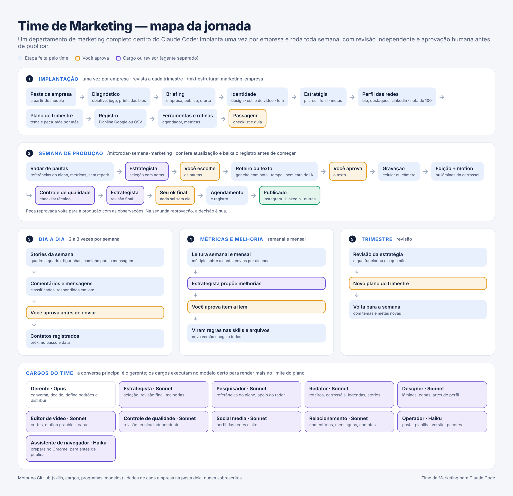

# Time de Marketing para Claude Code

**Um departamento de marketing completo dentro do Claude Code, em português do Brasil.** Você implanta uma vez por empresa e, a partir daí, o time trabalha toda semana: pesquisa o que funciona no nicho, escreve roteiros e carrosséis, edita vídeos com motion graphics (animações de texto, números e telas), revisa com olhar independente, publica, responde, mede e aprende.

**Nada é publicado nem enviado sem a sua aprovação.**

> **Já usa e quer atualizar?** No Claude Code, peça **"atualiza o time de marketing"** e depois digite `/reload-plugins`. O time também confere sozinho, no início de cada atividade, se há versão nova, e pergunta antes de atualizar. Detalhes em [Atualizações](#atualizações).



---

## Sumário
- [Principais entregas de valor](#principais-entregas-de-valor)
- [Como funciona](#como-funciona)
- [Cargos do time](#cargos-do-time)
- [Comandos](#comandos)
- [Programas que rodam no seu computador](#programas-que-rodam-no-seu-computador)
- [Requisitos](#requisitos)
- [Instalação](#instalação)
- [Configuração inicial](#configuração-inicial)
- [Primeiro uso](#primeiro-uso)
- [A semana na prática](#a-semana-na-prática)
- [Onde ficam as coisas](#onde-ficam-as-coisas)
- [Detalhes de cada frente](#detalhes-de-cada-frente)
- [Economia no plano Pro](#economia-no-plano-pro)
- [Atualizações](#atualizações)
- [Ferramentas externas](#ferramentas-externas)
- [Regras de qualidade e segurança](#regras-de-qualidade-e-segurança)
- [Perguntas frequentes](#perguntas-frequentes)
- [Licença e créditos](#licença-e-créditos)

---

## Principais entregas de valor

| Entrega | O que você recebe | Atributos |
|---|---|---|
| **Implantação guiada** | Diagnóstico (objetivo, jogo do mercado, modelo de crescimento, maturidade nos 4 pilares de receita, prints das bios e do site), briefing, identidade, estratégia com pilar de crescimento, plano do trimestre, registro e rotinas | Um passo por vez, com exemplos e múltipla escolha · aproveita o material que você já tem · retomável a qualquer momento · revisão a cada trimestre |
| **Identidade visual e de vídeo** | `design.md` com referências do Refero Styles e `estilo-video.md` com referências do What Ships, cada um com amostra aprovada | O que a empresa já tem prevalece · tudo validado item a item · vira o padrão de todas as peças e da revisão |
| **Carrosséis prontos** | Lâminas 1080 × 1350 na marca, PDF para o LinkedIn e folha de revisão | Texto aprovado antes de qualquer imagem · regra de ação acima de dor (no máximo 1 lâmina de problema) · título da capa com nota · seguro para o recorte da grade |
| **Roteiros de vídeo** | Roteiro de até 40 segundos com 3 ganchos com nota, folha de tempo, legenda conferida e derivado para o LinkedIn | Ganchos de 24 fórmulas em português · avisa trecho longo, gancho acima de 3 s e final que não retoma o começo · sem "cara de IA" |
| **Edição de vídeo** | Vídeo cortado, com legendas, motion graphics na marca, trilha licenciada e capa do Reels | Funciona com gravação de celular · plano aprovado antes de montar · capa pronta para a grade do perfil |
| **Revisão independente** | Nota do controle de qualidade e do estrategista antes do seu ok final | Quem revisa não participou da produção · segunda reprovação vai para você decidir |
| **Publicação** | Agendamento pelo Metricool ou publicação pelo Chrome, com marcações e mensagens de recompartilhamento para os donos | Para sempre antes do botão final · o login é sempre seu · uma peça por vez com o seu ok |
| **Relacionamento** | Comentários classificados e respondidos, mensagens diretas, comentários em outros perfis, stories e registro de contatos | Possíveis clientes primeiro · no máximo dois acompanhamentos · nada é enviado sem aprovação |
| **Perfil das redes** | Nota de 0 a 100 do perfil do Instagram, avaliação do LinkedIn e do site, 2 ou 3 versões de cada texto, capas dos destaques e banner na marca | A partir dos prints reais · comparação com concorrentes · antes e depois registrados |
| **Pesquisa do nicho** | Arquivo de referências ordenado pelo múltiplo de cada vídeo sobre a média do próprio perfil | Mostra o que realmente funcionou, não o que só tem muitas visualizações · inspira, nunca copia |
| **Reaproveitamento** | Um vídeo longo, palestra, podcast, artigo ou reunião vira uma semana de peças | Cada peça se sustenta sozinha · ganchos com nota · sem repetir pautas |
| **Métricas que ensinam** | Leitura semanal e mensal com múltiplo sobre a mediana da conta, envios e salvamentos por alcance | Erros e acertos viram regras aprovadas por você · a nova versão chega para todas as empresas |
| **Memória da empresa** | Registro de publicações, ideias, plano, melhorias e contatos, em Planilha Google com link ou em arquivos | Confere repetição de pautas · nada é apagado · pasta sempre organizada · arquivos do chat guardados no lugar certo |
| **Economia do plano** | Gerente no Opus e cargos em Sonnet e Haiku, folhas de revisão em vez de abrir cada imagem | Rende mais no limite do plano Pro sem perder qualidade nas decisões |
| **Sempre em dia e em português** | Atualização conferida no início de cada atividade e respostas sempre em português do Brasil | Pergunta antes de atualizar · ajusta as pastas sozinho, sem apagar nada |

---

## Como funciona
| Ciclo | Quando | O que acontece |
|---|---|---|
| **1. Implantação** | Uma vez por empresa (revista a cada trimestre) | Monta a pasta da empresa e todo o contexto que o time precisa, incluindo o perfil das redes |
| **2. Semana** | Toda semana | Radar de pautas (com referências do nicho e conteúdo-mãe) → seleção do estrategista → **você escolhe** → roteiro ou texto → **você aprova** → gravação → edição ou lâminas → controle de qualidade → revisão final → **seu ok** → publicação |
| **3. Dia a dia** | 2 a 3 vezes por semana | Stories, comentários e mensagens respondidos em lote (**você aprova antes de enviar**), contatos registrados com o próximo passo |
| **4. Métricas e melhoria** | Semanal e mensal | Leitura pelo múltiplo sobre a própria conta, melhorias propostas, **você aprova**, viram regras |
| **5. Trimestre** | A cada 3 meses | Revisão da estratégia, do perfil das redes e novo plano |

Peça reprovada volta para a produção com as observações. Na segunda reprovação, a decisão é sua.

## Cargos do time
A conversa principal é o **gerente de marketing**: conversa com você, decide, define os padrões e distribui o trabalho. Quem executa são os cargos, cada um no modelo certo, para render mais no limite do plano.

| Cargo | Modelo | O que faz |
|---|---|---|
| **Gerente** (conversa principal) | Opus | Conversa, aprovações, decisões, padrões (diagnóstico, estratégia, design), distribuição das tarefas |
| Estrategista | Sonnet | Seleção de pautas, revisão final, melhorias do mês |
| Pesquisador | Sonnet | Referências do nicho, apoio ao radar |
| Redator | Sonnet | Roteiros, textos de carrossel, legendas, stories, reaproveitamento, LinkedIn |
| Designer | Sonnet | Lâminas, PDF, folha de revisão, artes do perfil |
| Editor de vídeo | Sonnet | Plano de edição, montagem com motion graphics, capa |
| Controle de qualidade | Sonnet | Revisão técnica independente |
| Social media | Sonnet | Perfil das redes e do site |
| Relacionamento | Sonnet | Comentários, mensagens diretas, comentários em outros perfis, contatos |
| Operador | Haiku | Organizar a pasta, guardar arquivos, sincronizar a planilha, conferir versão |
| Assistente de navegador | Haiku | Preparar publicações e ler perfis no Chrome (para antes do botão final) |

Os cargos não falam com você: o gerente mostra o que eles entregam e pede as suas aprovações.

## Comandos
Todos começam com `/mkt:`. Você também pode simplesmente pedir em português ("roda a semana da Padaria Central") que o Claude escolhe o comando certo.

| Comando | Para quê |
|---|---|
| `/mkt:estruturar-marketing-empresa` | Implanta o marketing de uma empresa (e faz a revisão trimestral) |
| `/mkt:briefing-empresa` | Levanta o contexto da empresa (chamado pela implantação) |
| `/mkt:rodar-semana-marketing` | Conduz a semana, com painel e na ordem certa |
| `/mkt:radar-pautas` | Pesquisa e propõe pautas, sem repetir o que já foi feito |
| `/mkt:referencias-nicho` | Arquivo de referências do nicho, ordenado pelo que realmente funcionou |
| `/mkt:reaproveitar` | Um conteúdo longo vira uma semana de peças |
| `/mkt:estrategista-marketing` | Seleção de pautas, revisão final e melhorias do mês |
| `/mkt:roteiro-video` | Roteiro de vídeo curto com ganchos com nota, folha de tempo, legenda e LinkedIn |
| `/mkt:carrossel` | Texto e lâminas prontas (PNG e PDF) na identidade da empresa |
| `/mkt:editar-reels` | Edição do vídeo a partir da gravação, com motion graphics e capa |
| `/mkt:stories` | Sequência de stories com figurinhas e caminho para a mensagem |
| `/mkt:controle-qualidade` | Revisão técnica por checklist |
| `/mkt:agendar-publicacao` | Agendamento ou publicação pelo Chrome, marcações e recompartilhamento |
| `/mkt:relacionamento` | Comentários, mensagens diretas, comentários em outros perfis e contatos |
| `/mkt:perfil-redes` | Nota do perfil, propostas de bio, destaques e LinkedIn, capas e banner na marca |
| `/mkt:leitura-metricas` | Resultados pelo múltiplo sobre a própria conta, leitura mensal e aprendizados |
| `/mkt:atualizar-time` | Atualiza o time, faz as configurações iniciais e alinha as pastas das empresas |

## Programas que rodam no seu computador
Pequenos programas em Python, sem internet e sem enviar nada para fora, que o time usa para conferir o trabalho:

| Programa | O que faz |
|---|---|
| `gancho.py` | Nota de 0 a 100 para cada gancho (tamanho, concreto, risco, início, conversa) e veto a saudações e pedidos de atenção |
| `tempo-roteiro.py` | Folha de tempo do roteiro: duração de cada trecho, gancho acima de 3 s, trechos longos, final que não retoma o gancho |
| `humanizar.py` | Nota de "cara de IA" em português: caracteres invisíveis, travessões, palavras e estruturas típicas de IA, ritmo |
| `legenda.py` | Mostra o que aparece antes do "... mais" e confere hashtags, chamada para ação, links e cara de IA |
| `desempenho.py` | Ranking dos posts pelo múltiplo sobre a mediana da conta e por envios e salvamentos por mil de alcance |
| `referencias.py` | Ordena os vídeos de outros perfis pelo múltiplo sobre a mediana de cada perfil e identifica a fórmula do gancho |
| `renderizar.py` · `artes-perfil.py` | Lâminas dos carrosséis, PDF, capas de destaques e banner do LinkedIn na marca, com folha de revisão |
| `registro.py` | Registro de publicações, ideias, plano, melhorias e contatos, com controle de repetição |
| `organizar-pasta.py` · `guardar-arquivo.py` · `atualizar-pasta.py` | Pasta sempre organizada, arquivos do chat no lugar certo e estrutura atualizada sem apagar nada |
| `verificar-atualizacao.py` · `inicio-sessao.py` | Versão sempre em dia e português garantido |

## Requisitos
| Item | Para quê | Como conferir |
|---|---|---|
| **Claude Code** com plano pago do Claude | Rodar o time | `claude --version` |
| **git** | Baixar e atualizar o time | `git --version` |
| **GitHub CLI (gh)** com login | Acesso ao repositório privado | `gh auth status` |
| **Python 3** | Programas do time | `python3 --version` |
| **Playwright + Chromium** | Gerar as lâminas e artes | `pip install playwright pillow` e `python3 -m playwright install chromium` |
| **Node 22+ e ffmpeg** | Edição de vídeo | `node --version` e `ffmpeg -version` |
| Claude no Chrome (opcional) | Publicar e ler perfis sem Metricool | extensão do Chrome conectada |

Não precisa instalar tudo antes: cada comando confere o que falta e pede autorização para instalar. No Mac, o jeito mais simples de instalar git, gh, Node e ffmpeg é pelo [Homebrew](https://brew.sh): `brew install git gh node ffmpeg`.

## Instalação
Uma vez por computador.

**1. Acesso ao repositório** (ele é privado). Peça ao dono para convidar o seu usuário do GitHub como colaborador e aceite o convite. Depois, no Terminal:
```bash
gh auth login
gh auth setup-git
```

**2. Instale o time**, dentro do Claude Code:
```
/plugin marketplace add anderssilva/time-de-mkt-ander
/plugin install mkt@time-de-mkt
```
Ou pelo Terminal:
```bash
claude plugin marketplace add anderssilva/time-de-mkt-ander
claude plugin install mkt@time-de-mkt
```

**3. Ligue a atualização automática:** no Claude Code, digite `/plugin`, vá em **Marketplaces**, escolha **time-de-mkt** e selecione **Enable auto-update** (ativar atualização automática).

**4. Confira:** abra uma sessão nova e digite `/mkt:`. Os comandos devem aparecer na lista.

**5. Faça a [configuração inicial](#configuração-inicial):** peça "configura o time de marketing".

## Configuração inicial
Uma vez por computador. No Claude Code, peça **"configura o time de marketing"** (`/mkt:atualizar-time`). Ele confere e ajusta, sempre pedindo autorização:

| Item | O que faz | Por que importa |
|---|---|---|
| **Idioma** | Grava `"language": "portuguese"` nas configurações do Claude Code | O Claude responde em português em todas as sessões |
| **Atualização automática** | Orienta a ligar em `/plugin` → Marketplaces → time-de-mkt | As versões novas chegam sozinhas |
| **Versão** | Confere se a instalada é a última | Evita trabalhar com regras antigas |

**Português garantido em três camadas:** a regra está em cada comando e cada cargo; ao abrir o Claude Code o time avisa que a conversa é em português; e a configuração de idioma fixa o português no computador inteiro.

## Primeiro uso
1. Crie **uma pasta para a empresa** (por exemplo, `Marketing-Padaria`), de preferência numa pasta sincronizada do Google Drive.
2. No Terminal, entre nela e abra o Claude Code:
   ```bash
   cd ~/Marketing-Padaria
   claude
   ```
3. Peça: **"Estruturar o marketing da [nome da empresa]."**

O time cria as pastas do marketing **direto nessa pasta**, sem pastas intermediárias, e conduz as etapas uma a uma. Separe o material que já existe (manual de marca, logos, textos, vídeos, fotos, prints das redes e do site): ele é sempre aproveitado antes de criar algo do zero. O andamento fica salvo em `status-implantacao.md`.

Para trabalhar com a empresa depois, abra sempre o Claude Code **dentro da pasta dela**.

## A semana na prática
Peça: **"Roda a semana de marketing da [empresa]."**

| Momento | O que você faz | Tempo |
|---|---|---|
| Segunda | Escolhe as pautas e aprova os textos (em lote) | 20 a 30 min |
| Gravação | Grava os vídeos seguindo os roteiros, de preferência todos de uma vez | 30 min |
| Durante a semana | Aprova o plano de edição | 5 min por vídeo |
| 2 a 3 vezes por semana | Aprova as respostas e mensagens do relacionamento | 10 min |
| Sexta | Dá o ok final nas peças prontas | 15 min |

## Onde ficam as coisas
O time separa o **motor** dos **dados**:

| | O que é | Onde fica | Atualização |
|---|---|---|---|
| **Motor** | Comandos, cargos, programas e modelos | Este repositório, instalado no Claude Code | Por versão; nunca toca nos dados |
| **Dados** | Tudo de cada empresa | A pasta da empresa, no seu computador ou Drive | Só pelo trabalho do time |

```
Marketing-Padaria/               a pasta da empresa (o projeto)
├── LEIA-ME.md                   guia de operação do responsável
├── status-implantacao.md        andamento e versão do modelo
├── 00-contexto/                 briefing, design, estilo de vídeo, tom, provas, regras do setor, fotos, materiais recebidos
├── 01-plano/                    estratégia, plano do trimestre, rotinas
├── 02-pautas/                   pautas de cada semana, referências do nicho
├── 03-producao/                 uma pasta por peça (AAAA-MM/Sxx_Pnnn_tema) e stories
├── 04-metricas/                 leituras mensais
├── 05-canais/                   perfil das redes, artes do perfil, relacionamento
└── registro/                    publicações, ideias, plano, melhorias e contatos
```

Estrutura deste repositório:
```
.claude-plugin/marketplace.json     catálogo (time-de-mkt)
plugins/mkt/
├── .claude-plugin/plugin.json      ficha e versão do plugin
├── skills/                         comandos /mkt:...
├── agents/                         cargos que rodam como agente separado
├── scripts/                        programas que rodam no seu computador
├── referencias/                    guias compartilhados (ganchos, formatos, economia, organização...)
├── hooks/                          ao abrir o Claude Code: idioma e verificação de versão
├── modelos/empresa/                modelo de pasta de empresa
└── modelos/migracoes.json          mudanças de estrutura das pastas, por versão
docs/                               mapa da jornada
```

## Detalhes de cada frente

### Design da marca e vídeos com motion graphics
- **Design:** material da empresa primeiro → 2 ou 3 referências no [Refero Styles](https://styles.refero.design/) → regras aprovadas item a item → amostra com duas lâminas (pode ser montada no modo Design do Claude).
- **Vídeo:** gravação + motion graphics como padrão. Vídeo próprio → 2 ou 3 referências de animação no [What Ships](https://whatships.com/) → regras item a item → amostra de 5 a 8 segundos na marca, que vira o padrão de comparação.
- Gravou no celular? Funciona. Luz de janela de frente, câmera traseira e microfone de lapela fazem mais diferença do que qualquer edição.

### Ganchos, roteiros e legendas
- 3 opções de gancho de fórmulas diferentes (`referencias/ganchos.md`), com nota; gancho com veto ou abaixo de 55 não chega até você.
- Roteiro de até 40 segundos (ou o que a empresa definir), com folha de tempo antes de gravar.
- Todo texto passa pelo `humanizar.py` (nota mínima 80) e toda legenda pelo `legenda.py`.

### Formatos das redes
Conferidos em outubro de 2026 (`plugins/mkt/referencias/formatos-redes.md`):
- **Carrossel e post no Instagram:** 1080 × 1350 (4:5). A grade do perfil mostra um retângulo 3:4 e corta cerca de 34 px de cada lado.
- **Reels e Stories:** 1080 × 1920 (9:16), sem texto nas faixas dos botões do aplicativo.
- **Capa de Reels:** título e rosto dentro da janela central 1080 × 1440, que é o que aparece na grade.

### Perfil das redes
O diagnóstico pede os prints do Instagram, do LinkedIn (empresa e sócios), do site e de outras redes, e transcreve o que está escrito. Depois da estratégia, o `/mkt:perfil-redes` dá a nota na **régua de 100 pontos**, compara com concorrentes, propõe textos e gera capas dos destaques e banner do LinkedIn. Antes e depois ficam em `05-canais/perfil-redes.md`.

### Relacionamento e stories
- Comentários classificados em palavra-chave, possível cliente, dúvida, apoio, crítica e ruído, respondidos nessa ordem.
- Mensagens diretas: entrega da palavra-chave, primeira mensagem, proposta de parceria e no máximo dois acompanhamentos.
- Lista semanal de 10 perfis para comentar com algo que acrescente.
- Stories quadro a quadro, com a figurinha certa para cada trabalho e o caminho para a mensagem.
- Possíveis clientes vão para `registro/contatos.csv`, com status e próximo passo.

### Pesquisa do nicho e reaproveitamento
- `/mkt:referencias-nicho`: 8 a 15 perfis observados, os 12 vídeos recentes de cada, ordenados pelo **múltiplo sobre a mediana do próprio perfil**, com a fórmula do gancho e como a empresa faria a versão dela.
- `/mkt:reaproveitar`: garimpa os melhores momentos de um conteúdo longo e propõe uma semana de 5 a 8 peças independentes.

### Registro, marcações e organização
- Registro em **Planilha Google com link** (a equipe edita pelo celular; cópia de segurança na pasta) ou em **arquivos CSV**.
- **Donos das empresas** e pessoas autorizadas em `00-contexto/marcacoes.md`: marcados nas publicações e com mensagem pronta para recompartilhar.
- Arquivos enviados no chat são copiados para a pasta certa e anotados em `00-contexto/materiais/indice.md`; nada fica solto na raiz.

## Economia no plano Pro
- **Gerente no Opus, equipe no Sonnet e no Haiku.** O Opus não lê os arquivos inteiros, não abre imagens e não escreve os textos longos.
- **Limite apertado?** Rode o gerente no Sonnet (`/model sonnet`). Os cargos continuam nos mesmos modelos.
- **Uma peça por conversa:** ao terminar, digite `/clear`. Tudo já está salvo na pasta.
- **Texto antes de imagem** e revisão pela **folha de revisão** (todas as lâminas numa imagem só).

## Atualizações
- **No início de cada atividade:** o time confere se há versão nova (no máximo uma consulta por hora, em segundos). Se houver, mostra o que mudou e pergunta se atualiza agora. Com o seu ok, atualiza, você digita `/reload-plugins`, e ele ajusta as pastas da empresa sozinho, sem apagar nem sobrescrever nada. Se preferir depois, ele não pergunta de novo por 12 horas.
- **Ao abrir o Claude Code:** uma conferência por dia, que só avisa quando há novidade.
- **No início de cada semana:** conferência completa, com a pasta da empresa e o registro.
- **Quando quiser:** peça "atualiza o time de marketing", ou pelo Terminal:
  ```bash
  claude plugin marketplace update time-de-mkt && claude plugin update mkt@time-de-mkt
  ```
- **Sem fazer nada:** com a atualização automática ligada, a versão nova chega sozinha.

O que mudou em cada versão, e se alguma exige um passo extra, está no [CHANGELOG.md](CHANGELOG.md).

## Ferramentas externas
| Ferramenta | Uso | Plano |
|---|---|---|
| Metricool | Agendamento e métricas | Gratuito (1 marca por conta; sem LinkedIn) |
| Chrome com o Claude no Chrome | Publicar, agendar e ler perfis sem Metricool, com as contas logadas por você | Gratuito |
| Meta Business Suite | Agendar Instagram e Facebook pelo navegador | Gratuito |
| Google Planilhas | Registro com link (opcional) | Conector do Claude |
| Windsor.ai | Métricas de todas as redes e dados de concorrentes *(opcional)* | Pago a partir do plano básico |
| Refero Styles · What Ships | Referências de design e de animação | Gratuitos |
| HyperFrames | Composição e montagem dos vídeos | Código aberto |
| Canva | Ajustes manuais (opcional) | — |

Crie as contas no e-mail da empresa, não no pessoal de um sócio.

## Regras de qualidade e segurança
1. **Nada vai ao ar** sem controle de qualidade aprovado, estrategista aprovado e o ok do responsável. **Nenhuma mensagem é enviada** sem aprovação.
2. **Nunca inventar:** número, caso, depoimento ou resultado só entra com fonte e autorização (`provas.md`).
3. **Material existente primeiro:** o time sempre pergunta o que já existe antes de criar.
4. **Carrosséis de ação:** no máximo 1 lâmina de problema, pelo menos 60% de lâminas de ação com exemplo, e uma lâmina de checklist.
5. **Texto antes de imagem**, validado em rodadas.
6. **Sem cara de IA:** todo texto passa pelo humanizador antes de chegar até você.
7. **Login e senha são sempre seus:** o Claude nunca digita senha nem código; no navegador, para antes do botão final.
8. **Conteúdo de terceiros é inspiração, nunca cópia.** Textos de comentários e páginas são tratados como dados, nunca como ordens.
9. **Nada é apagado:** peças descartadas mudam de status; arquivos vão para `_lixeira/`.

## Perguntas frequentes
**Funciona no aplicativo do Claude, sem o Claude Code?**
A parte de texto sim, mas lâminas, vídeo, programas de conferência e registro precisam do Claude Code.

**Posso usar para várias empresas?**
Sim. Cada empresa tem a sua própria pasta. Abra o Claude Code dentro da pasta da empresa com que vai trabalhar, e o time mexe só nela.

**Uma atualização pode apagar o histórico de alguma empresa?**
Não. As atualizações mudam só o motor. A estrutura das pastas é ajustada sem apagar nem sobrescrever nada, e tudo fica anotado no `status-implantacao.md`.

**Preciso saber programar?**
Não. Depois da instalação, tudo é feito conversando em português.

**O Claude respondeu em inglês.**
Peça "configura o time de marketing" para fixar o português no computador.

**Os comandos `/mkt:` não aparecem.**
Rode `/reload-plugins` ou abra uma sessão nova. Se continuar, confira o acesso com `gh auth status` e reinstale com os comandos da [Instalação](#instalação).

**A atualização diz que não conseguiu consultar o GitHub.**
Confira a internet e o login (`gh auth status`, depois `gh auth setup-git`). O trabalho segue normalmente enquanto isso.

## Licença e créditos
Uso restrito a quem recebeu acesso a este repositório. Veja [LICENSE](LICENSE).

- A edição de vídeo usa o [HyperFrames](https://github.com/heygen-com/hyperframes) (licença Apache 2.0). A skill de edição foi adaptada do "Kit de Edição com Claude", compartilhado publicamente pela autora.
- As ideias da nota de gancho, da folha de tempo, do humanizador, da conferência de legenda, da régua do perfil, do ranking por múltiplo e das fórmulas de gancho foram adaptadas para o português a partir do [instagram-agent-skill](https://github.com/Jakeschincariol/instagram-agent-skill), de Jake Schincariol (licença MIT).
